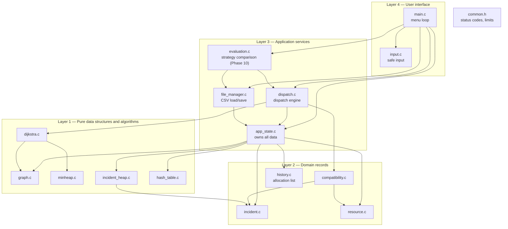
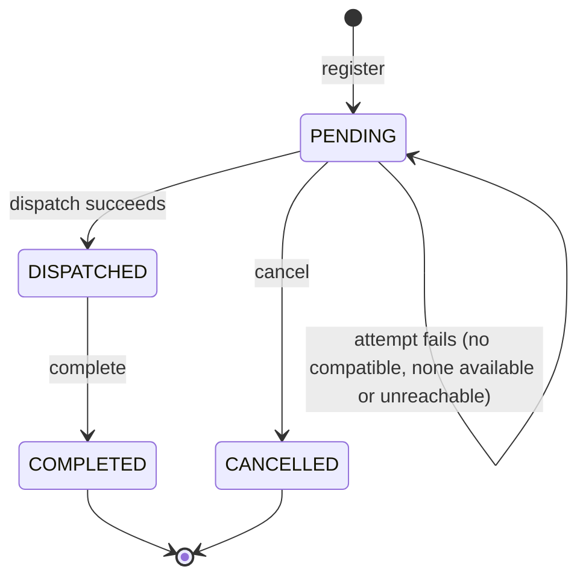
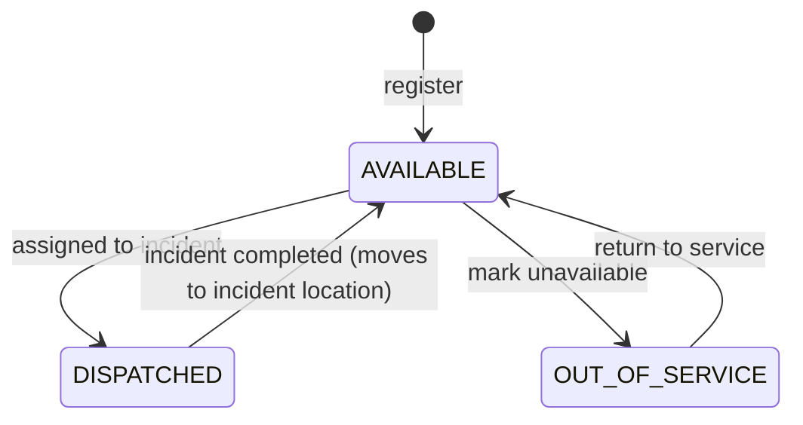
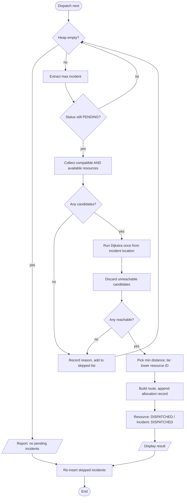
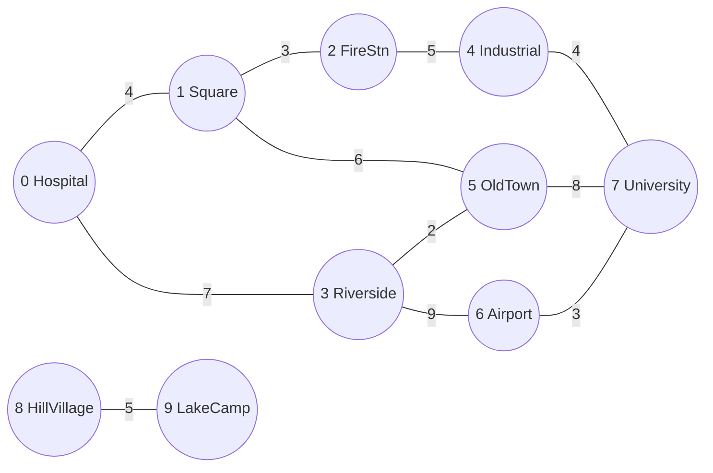

# DispatchCore — Phase 0 Blueprint

**Emergency Resource Allocation & Dispatch System (academic simulation in C11)**

Status: **DRAFT — awaiting team approval.** No code has been written yet. Nothing in this
document has been compiled or tested; every complexity figure below is a design-level
analysis, not a measurement.

> **Disclaimer.** DispatchCore is a classroom simulation of data structures and
> algorithms. Its severity scale, incident types and compatibility rules are invented
> project rules. It is not suitable for real emergency operations or clinical triage.

---

## Contents

1. Refined problem statement
2. Project objectives
3. System architecture
4. Module breakdown
5. Data structures and why each is needed
6. Proposed structure definitions
7. Incident priority rules
8. Resource compatibility matrix
9. Incident and resource state machines
10. Dispatch algorithm (pseudocode + flowchart)
11. Graph design (with our reference city)
12. File formats
13. Menu structure
14. Testing plan
15. Complexity analysis
16. Five-member task distribution
17. Development roadmap
18. Git workflow
19. Risks and implementation decisions
20. Concepts to learn before coding
21. Decisions we need you to approve

---

## 1. Refined problem statement

A city has several **locations** connected by **roads** of known (simulated) length.
**Incidents** (medical emergency, road accident, fire, structural collapse) are reported
at locations with a **severity** from 1 (minor) to 5 (critical). A limited fleet of
**resources** (ambulances, fire units, rescue units) is parked at various locations.

DispatchCore must repeatedly answer one question:

> *"Which pending incident should be served next, and which available, compatible unit
> can reach it by the shortest road distance?"*

It does so by:

- keeping pending incidents in a **binary max-heap** ordered by severity, then by report order;
- modelling the city as a **weighted undirected graph** stored as **adjacency lists**;
- computing shortest road distances with **Dijkstra's algorithm** driven by a **binary min-heap**;
- filtering resources by a **compatibility table** and by **availability** *before* comparing distance;
- finding records by ID in O(1) average time with **hash tables** (separate chaining);
- recording every allocation in a **linked-list history**;
- persisting everything in **CSV files**;
- comparing a **baseline** dispatch strategy against the **optimized** one on identical,
  reproducible simulated data.

Out of scope: real maps, real-time clocks, traffic, GPS, multi-unit incidents (optional
extension only), and any claim of real-world fitness.

---

## 2. Project objectives

| # | Objective | Where it is met |
|---|-----------|-----------------|
| O1 | Prioritize incidents | `incident_heap` (max-heap) |
| O2 | Manage resources | `resource`, `compatibility` |
| O3 | Model the road network | `graph` (adjacency list) |
| O4 | Compute shortest routes | `minheap` + `dijkstra` |
| O5 | Pick nearest suitable available unit | `dispatch` |
| O6 | Keep incident and allocation records | `incident`, `history`, `file_manager` |
| O7 | Hand-written data structures | every module above, no external libraries |
| O8 | Complexity analysis | §15 + per-phase docs |
| O9 | Compare dispatch strategies | `evaluation` (Phase 10) |
| O10 | Professional terminal application | `main`, `input` |

---

## 3. System architecture

The program is organised in **four layers**. A module may only depend on modules in its
own layer or below. That rule is what prevents circular `#include`s.



### The central idea: one `AppState`, passed by pointer

All live data (graph, incidents, resources, heap, hash tables, history) lives in **one
struct, `AppState`**, created in `main()` and passed as `AppState *` to every function
that needs it. Consequences:

- **No mutable global variables.** Every function's inputs are visible in its parameter list,
  which makes testing easy: a test can create its own private `AppState`.
- The strategy comparison can build a *second, independent* `AppState` from a scenario
  folder, so experiments **never touch live data**.
- The only globals are `const` lookup tables (compatibility matrix, enum-to-string names).
  They are read-only, so they cannot cause hidden state bugs.

### Ownership rule (memorise this — it prevents most memory bugs)

| Data | Owned (malloc'd and freed) by | Only *borrowed* (pointer copies) by |
|------|-------------------------------|--------------------------------------|
| `Incident` records | `IncidentStore` | `IncidentHeap`, incident `HashTable` |
| `Resource` records | `ResourceStore` | resource `HashTable` |
| `Allocation` records | `AllocationList` | — |
| Graph nodes/edges | `Graph` | — |

Each record is `malloc`'d **individually**, so its address never changes. The heap and hash
tables store pointers to it. Only the owner calls `free` on it, and only during shutdown.
(If we stored records directly in a `realloc`-grown array, every `realloc` could move them and
silently invalidate all pointers held by the heap and hash tables. That is a classic bug.)

---

## 4. Module breakdown

```
DispatchCore/
├── Makefile
├── README.md
├── src/
│   ├── common.h            status codes, size limits, shared constants (header only)
│   ├── input.h / .c        safe fgets/strtol-based input helpers
│   ├── graph.h / .c        locations + adjacency-list road network
│   ├── minheap.h / .c      binary min-heap of (vertex, distance) for Dijkstra
│   ├── dijkstra.h / .c     shortest paths, route reconstruction, O(V^2) reference version
│   ├── incident.h / .c     Incident struct, enums, validation, IncidentStore
│   ├── incident_heap.h / .c binary max-heap of Incident* (priority queue)
│   ├── resource.h / .c     Resource struct, enums, status transitions, ResourceStore
│   ├── compatibility.h / .c incident-type x resource-type table
│   ├── hash_table.h / .c   int key -> pointer, separate chaining
│   ├── history.h / .c      allocation records in a singly linked list
│   ├── app_state.h / .c    AppState: create, destroy, lookups
│   ├── dispatch.h / .c     dispatch engine, completion, cancellation, statistics
│   ├── file_manager.h / .c CSV loading/saving with validation
│   ├── evaluation.h / .c   baseline vs optimized comparison (Phase 10)
│   └── main.c              menu and program loop
├── tests/
│   ├── test_util.h         tiny assertion macros (CHECK, CHECK_EQ_INT, ...)
│   ├── test_graph.c, test_minheap.c, test_dijkstra.c, test_incident_heap.c,
│   ├── test_resource.c, test_hash_table.c, test_history.c, test_dispatch.c,
│   ├── test_file_manager.c
│   └── e2e/                scripted menu inputs + expected outputs
├── data/                   live CSV files (the running program reads/writes these)
│   └── scenarios/          read-only datasets for experiments (s1_small, s2_medium, ...)
└── docs/                   this blueprint, phase notes, test reports, viva notes
```

**Changes from the suggested structure, and why**

| Change | Reason |
|--------|--------|
| `heap.c` renamed to `incident_heap.c` | The project has two heaps. "heap" alone is ambiguous in viva and in code. |
| Dijkstra moved out of `graph.c` into `dijkstra.c` | The graph is a data structure; Dijkstra is an algorithm that *uses* it plus the min-heap. Separating them means `graph.c` is testable alone (Phase 1) and Dijkstra arrives cleanly in Phase 2. |
| Added `compatibility.c` | It needs both incident types and resource types. Putting it in either module would make that module depend on the other. A tiny separate module keeps dependencies one-directional and makes the rules easy to change. |
| Added `app_state.c` | Holds the single `AppState`. Both `dispatch.c` and `file_manager.c` need it; neither should depend on the other. |
| Added `input.c` | Every menu option reads validated integers/strings. Writing that once avoids duplicated, inconsistent `scanf` code. |
| Added `common.h` | One shared set of return codes and limits. |
| `evaluation.c` deferred | Only built in Phase 10, after the core works. |
| `src/`, `tests/`, `docs/` folders | Keeps 30+ files navigable; the Makefile handles paths. |

---

## 5. Data structures and why each is needed

| Data structure | Used for | Why this one (and not an alternative) |
|---|---|---|
| **Binary max-heap** (array of `Incident*`) | Pending-incident priority queue | Insert and extract-max are O(log n). A sorted array would make insert O(n); an unsorted array would make extract O(n). |
| **Binary min-heap** (array of `{vertex, dist}`) | Dijkstra's "closest unvisited vertex" | Turns Dijkstra from O(V²) into O((V+E) log V), which matters for sparse road networks. |
| **Weighted graph, adjacency list** (array of linked lists) | Road network | Road networks are *sparse* (each junction has few roads). Adjacency lists use O(V+E) memory; a matrix wastes O(V²) and makes "visit all neighbours" cost O(V). |
| **Hash table with separate chaining** | Incident ID → record, Resource ID → record | O(1) average lookup for "complete incident 1007", "find resource 4". Chaining handles collisions with simple linked lists and never "fills up". |
| **Singly linked list with tail pointer** | Allocation history | Records are only appended and scanned in order. O(1) append with a tail pointer; no resizing; order of events is preserved naturally. |
| **Linked lists inside the graph and hash table** | Adjacency lists, hash buckets | These are the textbook, justified uses of linked lists. |
| **Dynamic array of pointers** (`Incident **`, `Resource **`) | Master record stores | Ordered listing ("View all") and saving need registration order. Index access is O(1). Pointer arrays can be `realloc`'d safely because the records themselves don't move. |
| **Path array + predecessor array** | Route reconstruction | Dijkstra fills `prev[v]`; following it backwards from the destination rebuilds the route. |

**Deliberately not added:** a linked list of incidents or resources (redundant with the
pointer arrays), a separate "event log" list (the allocation list plus incident statuses
already capture every event), trees (no ordered-range queries are needed).

---

## 6. Proposed structure definitions

These are **proposals**. Exact field names may be adjusted in the phase that implements
them, and any change will be stated explicitly.

### `common.h`

```c
#ifndef DC_COMMON_H
#define DC_COMMON_H

typedef enum {
    DC_OK = 0,
    DC_ERR_NOMEM,      /* malloc/realloc failed */
    DC_ERR_INVALID,    /* bad argument or bad input value */
    DC_ERR_NOT_FOUND,  /* ID does not exist */
    DC_ERR_DUPLICATE,  /* ID/edge already exists */
    DC_ERR_EMPTY,      /* heap/list is empty */
    DC_ERR_STATE,      /* illegal status transition */
    DC_ERR_IO          /* file could not be read/written */
} DcStatus;

#define DC_NAME_MAX       32     /* location names, incl. '\0' */
#define DC_LINE_MAX       512    /* longest accepted CSV line */
#define DC_MAX_WEIGHT     10000  /* max road length; keeps sums far below INT_MAX */
#define DC_MAX_VERTICES   1000
#define DC_INF            (-1)   /* "unreachable" marker in distance arrays (see §11) */

const char *dc_status_str(DcStatus s);
#endif
```

### Graph (`graph.h`)

```c
typedef struct AdjNode {
    int dest;               /* neighbouring vertex index */
    int weight;             /* road distance, 1..DC_MAX_WEIGHT */
    int is_closed;          /* 0 = open; 1 = closed (optional road-closure feature) */
    struct AdjNode *next;   /* next road leaving the same vertex */
} AdjNode;

typedef struct {
    int  id;                     /* == vertex index 0..V-1 */
    char name[DC_NAME_MAX];
} Location;

typedef struct {
    int       num_vertices;
    int       num_edges;         /* undirected roads (each stored twice) */
    Location *locations;         /* array [num_vertices] */
    AdjNode **adj;               /* array [num_vertices] of list heads */
} Graph;
```

### Min-heap for Dijkstra (`minheap.h`)

```c
typedef struct { int vertex; int dist; } MinHeapEntry;

typedef struct {
    MinHeapEntry *data;   /* data[0] is the smallest dist */
    int size;
    int capacity;         /* grows by doubling */
} MinHeap;
```

### Shortest-path result (`dijkstra.h`)

```c
typedef struct {
    int  source;
    int  num_vertices;
    int *dist;   /* dist[v] = shortest distance from source, or DC_INF */
    int *prev;   /* prev[v] = previous vertex on the best path, -1 if none */
} ShortestPaths;
```

### Incident (`incident.h`)

```c
typedef enum {
    INC_MEDICAL = 0, INC_ROAD_ACCIDENT, INC_FIRE, INC_STRUCTURAL_RESCUE,
    INC_TYPE_COUNT
} IncidentType;

typedef enum {
    INC_PENDING = 0, INC_DISPATCHED, INC_COMPLETED, INC_CANCELLED,
    INC_STATUS_COUNT
} IncidentStatus;

typedef struct {
    int            id;                    /* unique, e.g. 1001, 1002, ... */
    IncidentType   type;
    int            location_id;           /* graph vertex */
    int            severity;              /* 1 (minor) .. 5 (critical) */
    long           reported_seq;          /* simulation clock tick at registration; unique */
    IncidentStatus status;
    int            assigned_resource_id;  /* -1 when none */
    int            dispatch_attempts;     /* failed attempts, for reporting */
} Incident;

typedef struct {
    Incident **items;   /* owns each Incident; registration order */
    int count;
    int capacity;
} IncidentStore;
```

### Incident max-heap (`incident_heap.h`)

```c
typedef struct {
    Incident **data;   /* borrowed pointers; data[0] = highest priority */
    int size;
    int capacity;
} IncidentHeap;
```

### Resource (`resource.h`)

```c
typedef enum {
    RES_AMBULANCE = 0, RES_FIRE_UNIT, RES_RESCUE_UNIT,
    RES_TYPE_COUNT
} ResourceType;

typedef enum {
    RES_AVAILABLE = 0, RES_DISPATCHED, RES_OUT_OF_SERVICE,
    RES_STATUS_COUNT
} ResourceStatus;

typedef struct {
    int            id;                    /* unique, e.g. 1, 2, 3 */
    ResourceType   type;
    int            location_id;           /* current vertex */
    ResourceStatus status;
    int            assigned_incident_id;  /* -1 when none */
    int            total_dispatches;      /* statistics */
    long           total_distance;        /* statistics: sum of route lengths */
} Resource;

typedef struct {
    Resource **items;   /* owns; registration order (baseline strategy depends on it) */
    int count;
    int capacity;
} ResourceStore;
```

*Justification of extra fields:* `assigned_*` IDs make "active dispatches" and consistency
checks O(1); `total_*` fields feed system statistics without rescanning history;
`RES_OUT_OF_SERVICE` lets us demo "unit exists but cannot be dispatched".

### Hash table (`hash_table.h`)

```c
typedef struct HashNode {
    int key;                 /* incident or resource ID */
    void *value;             /* borrowed pointer to the record */
    struct HashNode *next;   /* next node in the same bucket (chaining) */
} HashNode;

typedef struct {
    HashNode **buckets;      /* array [num_buckets] of list heads */
    int num_buckets;         /* a prime, e.g. 17 or 101 */
    int count;
} HashTable;
```

`void *` makes one implementation serve both incidents and resources. The price is that C
cannot check that we store `Resource *` in the resource table; `app_state.c` wraps it in
typed functions (`app_find_incident`, `app_find_resource`) so the rest of the code never
casts.

### Allocation history (`history.h`)

```c
typedef enum { ALLOC_ACTIVE = 0, ALLOC_COMPLETED } AllocationStatus;

typedef struct Allocation {
    int   id;
    int   incident_id;
    int   resource_id;
    int   from_location;          /* resource position at dispatch */
    int   to_location;            /* incident location */
    int   distance;
    int  *route;                  /* malloc'd vertex sequence from -> to */
    int   route_len;
    AllocationStatus status;
    long  dispatch_seq;
    long  complete_seq;           /* -1 while active */
    struct Allocation *next;
} Allocation;

typedef struct {
    Allocation *head;
    Allocation *tail;             /* O(1) append */
    int count;
} AllocationList;
```

### Application state (`app_state.h`)

```c
typedef struct {
    Graph          *graph;
    IncidentStore   incidents;
    ResourceStore   resources;
    IncidentHeap    pending;          /* only PENDING incidents (see lazy deletion, §9) */
    HashTable      *incident_index;
    HashTable      *resource_index;
    AllocationList  history;
    int  next_incident_id;
    int  next_resource_id;
    int  next_allocation_id;
    long clock;                       /* simulated time: +1 per event */
} AppState;
```

---

## 7. Incident priority rules

**Severity scale (project rule):** 1 Minor · 2 Moderate · 3 Serious · 4 Severe · 5 Critical.
Input outside 1..5 is rejected.

**Ordering — incident A has higher priority than B if:**

1. `A.severity > B.severity`, otherwise
2. severities are equal and `A.reported_seq < B.reported_seq` (reported earlier).

`reported_seq` comes from `AppState.clock`, which increases by 1 on every event, so **no two
incidents share a sequence number**. That makes the order **total and deterministic**: no
two incidents are ever "equal", so the same input always yields the same dispatch order on
every machine. We deliberately use a simulated clock instead of `time()` because wall-clock
times can tie (same second) and make tests irreproducible.

```c
/* returns 1 if a must be served before b */
int incident_higher_priority(const Incident *a, const Incident *b) {
    if (a->severity != b->severity) return a->severity > b->severity;
    return a->reported_seq < b->reported_seq;
}
```

The **heap invariant**: for every index `i > 0`,
`incident_higher_priority(data[i], data[parent(i)])` is false, i.e. no child outranks its
parent. Therefore `data[0]` is always the highest-priority incident. With 0-based indexing:
`parent(i) = (i-1)/2`, `left(i) = 2i+1`, `right(i) = 2i+2`.

---

## 8. Resource compatibility matrix

Simplified project rules (not real protocols):

| Incident type ↓ / Resource → | Ambulance | Fire unit | Rescue unit |
|---|:---:|:---:|:---:|
| Medical emergency | ✅ | ❌ | ❌ |
| Road accident | ✅ | ❌ | ✅ |
| Fire | ❌ | ✅ | ❌ |
| Structural rescue | ❌ | ❌ | ✅ |

Implemented as one read-only table so the rules can be changed in one place:

```c
static const int COMPAT[INC_TYPE_COUNT][RES_TYPE_COUNT] = {
    /*                 AMB FIRE RESCUE */
    /* MEDICAL    */ {  1,  0,   0 },
    /* ROAD_ACC   */ {  1,  0,   1 },
    /* FIRE       */ {  0,  1,   0 },
    /* STRUCTURAL */ {  0,  0,   1 },
};

int is_compatible(IncidentType it, ResourceType rt);   /* bounds-checked lookup */
```

**Rule enforced by design:** the dispatch engine filters by compatibility and availability
*first*, and only then compares distances. An incompatible unit is never even placed in the
candidate list, so it cannot win by being closer.

---

## 9. State machines

### Incident



| Transition | Allowed? | Side effects |
|---|---|---|
| PENDING → DISPATCHED | yes | removed from heap (by extract), `assigned_resource_id` set, allocation created |
| PENDING → CANCELLED | yes | stays in heap but is skipped (lazy deletion, below) |
| DISPATCHED → COMPLETED | yes | resource released, allocation marked completed |
| DISPATCHED → CANCELLED | **no** (project rule: recall of a moving unit is out of scope) | — |
| COMPLETED/CANCELLED → anything | **no** (terminal states) | — |

All transitions go through one function, `incident_set_status()`, which returns
`DC_ERR_STATE` for anything not in the table.

**Lazy deletion for cancellation.** Removing an arbitrary element from a binary heap needs
its index, which requires extra bookkeeping. Instead, cancelling only changes the status. When
the dispatch engine extracts an incident whose status is no longer `PENDING`, it discards it
and extracts again. Cost: a cancelled incident occupies a heap slot until it reaches the top.
Alternative (discussed in viva): store each incident's heap index and implement
`heap_remove_at(i)` in O(log n).

### Resource



DISPATCHED → OUT_OF_SERVICE is **not** allowed: a unit must finish its job first. This
guarantees the requirement "a dispatched resource must not be assigned again until it has
been released" in one place, `resource_set_status()`.

**Location after completion:** the unit is at the incident scene, so its `location_id`
becomes the incident location. This is the simplest defensible rule and makes later
dispatches depend on earlier ones (good for demos). Alternative extension: a `home_location`
field and an explicit "return to base" action.

---

## 10. Dispatch algorithm

### Key optimisation: one Dijkstra per incident, not one per resource

Roads are **undirected**, so distance(resource → incident) = distance(incident → resource).
Running Dijkstra **once from the incident's location** gives the distance from *every*
location, so we can read every candidate's distance from a single `dist[]` array.
Cost: one O((V+E) log V) run instead of R runs. Following `prev[]` from the resource's
location back to the incident yields the route, which we reverse to get *resource → incident*.
*(If roads ever became one-way, we would run Dijkstra on the reversed graph instead.)*

### Tie-breaking

- Two candidates at equal distance → the **lower resource ID** wins (deterministic, documented).
- Two equal-length paths to the same vertex → Dijkstra keeps the **first one found**
  (we update only on strictly smaller distance), and the adjacency order is fixed by load
  order, so the reported route is reproducible.

### Avoiding head-of-line blocking without infinite loops

If the top incident cannot be served (for example, a fire with no fire unit free), it must
not block every other incident, and we must not pop/reinsert it forever. The engine therefore
makes **one bounded pass**: each pending incident is tried **at most once per command**.

```text
function DISPATCH_NEXT(state):
    skipped ← empty temporary array
    result  ← NOTHING_DISPATCHED
    while heap is not empty:
        inc ← HEAP_EXTRACT_MAX(state.pending)            // O(log n)
        if inc.status ≠ PENDING: continue                  // lazy-deleted (cancelled)
        outcome ← TRY_ALLOCATE(state, inc)
        if outcome.success:
            result ← outcome
            break
        inc.dispatch_attempts ← inc.dispatch_attempts + 1
        report "Incident inc.id kept pending: " + outcome.reason
        append inc to skipped
    for each inc in skipped:                               // put back what we couldn't serve
        HEAP_INSERT(state.pending, inc)
    return result
// Termination: every iteration removes one element from the heap and nothing is
// re-inserted until after the loop, so the loop runs at most heap.size times.

function TRY_ALLOCATE(state, inc):
    candidates ← []
    for each r in state.resources (registration order):     // O(R)
        if not IS_COMPATIBLE(inc.type, r.type): continue     // filter 1: capability
        if r.status ≠ AVAILABLE: continue                    // filter 2: availability
        append r to candidates
    if candidates is empty:
        return FAIL(any compatible unit exists ? "all compatible units busy"
                                               : "no compatible unit registered")
    sp ← DIJKSTRA(state.graph, inc.location_id)              // one run, §10 key idea
    best ← NONE
    for each r in candidates:
        d ← sp.dist[r.location_id]
        if d = DC_INF: continue                              // filter 3: reachability
        if best = NONE or d < best.dist
           or (d = best.dist and r.id < best.r.id):          // deterministic tie-break
            best ← (r, d)
    if best = NONE:
        free sp; return FAIL("compatible units exist but none can reach location")
    route ← REVERSE(BUILD_PATH(sp, best.r.location_id))      // resource → incident
    // commit — only after every check passed, so a failure leaves no half-updated state
    allocation ← HISTORY_APPEND(inc, best.r, route, best.dist, state.clock)
    if allocation failed (out of memory): free sp; return FAIL("out of memory")
    RESOURCE_SET_STATUS(best.r, DISPATCHED); best.r.assigned_incident_id ← inc.id
    INCIDENT_SET_STATUS(inc, DISPATCHED);   inc.assigned_resource_id ← best.r.id
    state.clock ← state.clock + 1
    free sp
    return SUCCESS(allocation)

function COMPLETE_INCIDENT(state, incident_id):
    inc ← HASH_FIND(incident_index, incident_id)   ; must exist and be DISPATCHED
    r   ← HASH_FIND(resource_index, inc.assigned_resource_id)
    alloc ← HISTORY_FIND_ACTIVE(incident_id)
    INCIDENT_SET_STATUS(inc, COMPLETED)
    r.location_id ← inc.location_id
    RESOURCE_SET_STATUS(r, AVAILABLE); r.assigned_incident_id ← -1
    alloc.status ← COMPLETED; alloc.complete_seq ← state.clock; state.clock++

function CANCEL_INCIDENT(state, incident_id):
    inc ← HASH_FIND(...)                            ; must be PENDING
    INCIDENT_SET_STATUS(inc, CANCELLED)              ; heap entry skipped later
```

An optional menu item **"Dispatch all possible"** repeats `DISPATCH_NEXT` until a call
dispatches nothing. That is also bounded: each successful call permanently removes one
incident from the pending set.

### Flowchart



### Worked example (on the reference city in §11)

Incident: **MEDICAL, severity 4, at location 5 (Old Town).**
Dijkstra from 5 gives `dist = {0:9, 1:6, 2:9, 3:2, 4:12, 5:0, 6:11, 7:8, 8:∞, 9:∞}`.

| Resource | Type | At | Compatible? | Available? | Distance |
|---|---|---|---|---|---|
| R1 | Ambulance | 0 Central Hospital | yes | yes | 9 |
| R2 | Ambulance | 6 Airport Road | yes | yes | 11 |
| R3 | Fire unit | 2 Fire Station North | **no** | — | — |
| R4 | Rescue unit | 4 Industrial Zone | **no** | — | — |
| R5 | Fire unit | 7 University | **no** (even though only 8 away) | — | — |
| R6 | Ambulance | 8 Hill Village | yes | yes | ∞ → excluded |

Winner: **R1, distance 9, route 0 → 3 → 5.** R5 is the closest unit overall but is
correctly ignored as incompatible; R6 is compatible but unreachable.
*(Hand-calculated during planning; will be verified by `test_dijkstra.c` in Phase 2.)*

---

## 11. Graph design

- **Vertices = locations**, numbered `0..V-1`. A location's ID *is* its array index, so
  lookups are O(1) without a hash table. Names are stored alongside.
- **Edges = roads**, undirected: `graph_add_road(g, u, v, w)` inserts `v` into `u`'s list
  *and* `u` into `v`'s list.
- **Weights:** integers 1..10000. Zero and negative weights are rejected because Dijkstra is
  only correct for non-negative weights; zero-length roads are meaningless here.
- **Self-loops** (u = v) rejected. **Duplicate roads** rejected with `DC_ERR_DUPLICATE`
  (checking costs O(deg(u)), which is tiny for road networks).
- **New nodes are inserted at the head** of the list (O(1)). Consequence: display order is
  reverse insertion order. Documented, and tests account for it.
- **Unreachable** is represented by `DC_INF` (-1) in `dist[]` rather than `INT_MAX`, so that no
  code path ever computes `INT_MAX + w` (signed overflow is undefined behaviour in C).
  Inside Dijkstra the check is explicit: `if (dist[v] == DC_INF || dist[u] + w < dist[v])`.
  With V ≤ 1000 and w ≤ 10000, the longest possible path is below 10⁷, far from `INT_MAX`.
- **Disconnected components** are allowed and expected (the island in our reference city).
- **Road closures (optional):** `is_closed = 1` on both directions; Dijkstra skips closed edges.

### Reference city (used in every phase's examples and tests)

| ID | Location | | ID | Location |
|---|---|---|---|---|
| 0 | Central Hospital | | 5 | Old Town |
| 1 | City Square | | 6 | Airport Road |
| 2 | Fire Station North | | 7 | University |
| 3 | Riverside | | 8 | Hill Village |
| 4 | Industrial Zone | | 9 | Lake Camp |

Roads (distance units): 0–1 (4), 0–3 (7), 1–2 (3), 1–5 (6), 2–4 (5), 3–5 (2), 3–6 (9),
4–7 (4), 5–7 (8), 6–7 (3), and a separate component 8–9 (5).



### Interfaces (Phase 1 & 2)

```c
/* graph.h */
Graph   *graph_create(int num_vertices);                       /* NULL on failure */
void     graph_destroy(Graph *g);                              /* safe on NULL */
DcStatus graph_set_location_name(Graph *g, int id, const char *name);
DcStatus graph_add_road(Graph *g, int u, int v, int weight);
DcStatus graph_set_road_closed(Graph *g, int u, int v, int closed);  /* optional */
int      graph_is_valid_vertex(const Graph *g, int v);
const char *graph_location_name(const Graph *g, int v);
void     graph_print(const Graph *g, FILE *out);
int      graph_count_components(const Graph *g);                /* BFS; for stats/tests */

/* minheap.h */
DcStatus minheap_init(MinHeap *h, int initial_capacity);
void     minheap_free(MinHeap *h);
DcStatus minheap_push(MinHeap *h, int vertex, int dist);
DcStatus minheap_pop(MinHeap *h, MinHeapEntry *out);
int      minheap_is_empty(const MinHeap *h);

/* dijkstra.h */
DcStatus dijkstra_run(const Graph *g, int source, ShortestPaths *out);
DcStatus dijkstra_run_array(const Graph *g, int source, ShortestPaths *out); /* O(V^2) reference */
void     shortest_paths_free(ShortestPaths *sp);
int      dijkstra_build_path(const ShortestPaths *sp, int dest, int *path_out, int max_len);
                                     /* returns path length, 0 if unreachable */
```

**Dijkstra variant chosen:** "lazy" binary min-heap. When a shorter distance to `v` is
found we simply push a new `(v, dist)` entry; when an entry is popped whose `dist` is larger
than the current `dist[v]`, it is stale and skipped. This avoids the index-tracking that a
`decrease-key` operation needs, keeps the same O((V+E) log V) bound (the heap holds at most
E+1 entries and log E ≤ 2 log V), and is the version used in most modern references. The
O(V²) array version is kept as a **correctness oracle** in tests and for the Phase 10
performance comparison — it is *not* a silent replacement.

---

## 12. File formats

All files: UTF-8/ASCII, comma-separated, **one header row**, no quoting. Enum values are
stored as **text** (`AMBULANCE`, `PENDING`) so files are human-readable and robust to enum
reordering.

| File | Header | Example row |
|---|---|---|
| `locations.csv` | `location_id,name` | `5,Old Town` |
| `roads.csv` | `from_id,to_id,distance,status` | `3,5,2,OPEN` |
| `resources.csv` | `resource_id,type,location_id,status,assigned_incident_id,total_dispatches,total_distance` | `1,AMBULANCE,0,AVAILABLE,-1,0,0` |
| `incidents.csv` | `incident_id,type,location_id,severity,reported_seq,status,assigned_resource_id,dispatch_attempts` | `1001,MEDICAL,5,4,12,PENDING,-1,0` |
| `allocations.csv` | `allocation_id,incident_id,resource_id,from_location,to_location,distance,route,status,dispatch_seq,complete_seq` | `1,1001,1,0,5,9,0\|3\|5,ACTIVE,13,-1` |

The route uses `|` between vertices so it fits in a single CSV field.

### Loading rules

1. **Order:** locations → roads → resources → incidents → allocations (each later file refers
   to IDs from earlier ones).
2. **Missing file:** not an error. Start with an empty set and print a notice
   (`locations.csv` missing ⇒ empty city, and the menu explains how to add data).
3. **Each line** is read with `fgets` into a 512-byte buffer. A line longer than that is
   reported and skipped entirely (we read and discard up to the next `'\n'`).
4. **Trailing `\r\n`** (Windows line endings) is stripped, so files edited in Notepad still load.
5. **Each field** is parsed with `strtol` and checked: whole field consumed, within range,
   referenced IDs exist, enum text recognised, no duplicate IDs.
6. **Malformed row ⇒ skipped**, with a warning naming the file and line number. A load
   summary prints `loaded / skipped` counts. A bad row never partially updates state.
7. **Cross-checks after loading:** every `ACTIVE` allocation must match a `DISPATCHED`
   incident and a `DISPATCHED` resource, and vice versa. Inconsistencies are reported; the
   program does **not** silently "fix" data.
8. **Rebuild derived structures:** insert every `PENDING` incident into the heap; insert every
   record into its hash table; set `next_*_id = max ID + 1`; set `clock = max seq + 1`.

### Saving rules (avoiding corruption)

1. Write to `name.csv.tmp`. Check every `fprintf` and the final `fclose` for errors.
2. Only if everything succeeded: rename the old `name.csv` to `name.csv.bak`, then rename
   `name.csv.tmp` to `name.csv`. (Windows `rename()` fails if the destination exists, hence
   the explicit `.bak` step.)
3. If any step fails, the original file is left untouched and an error is shown.
4. **When:** after every state-changing operation (auto-save, can be disabled with a
   command-line flag for experiments), and from the "Save" menu item.

### CSV limitations (we will state these openly)

- Names cannot contain commas or newlines (input validation rejects them).
- No types or schema: any text editor can break a file, which is why loading validates.
- Whole-file rewrite on every save: O(N) per save. Fine for hundreds of records; a real
  system would use a database or append-only log.
- Rename is "atomic enough" on a local disk but **not guaranteed** on all filesystems.
  OneDrive-synced folders can briefly lock files (see §19).
- No concurrent access: one program instance at a time.

---

## 13. Menu structure

A single numbered menu with section headers (faster to demo than nested menus).

```
================ DispatchCore ================
 INCIDENTS
   1. Register incident
   2. View pending incidents (priority order)
   3. View all incidents
   4. Search incident by ID
   5. Cancel pending incident
 RESOURCES
   6. Register resource
   7. View available resources
   8. View all resources
   9. Search resource by ID
  10. Change resource service status (in/out of service)
 DISPATCH
  11. Dispatch next emergency
  12. Dispatch all possible            [optional]
  13. View active dispatches
  14. Complete incident
 ROAD NETWORK
  15. Display road network
  16. Find shortest route
  17. Close / reopen road              [optional]
 REPORTS
  18. Allocation history
  19. System statistics
  20. Compare dispatch strategies      [Phase 10]
  21. Hash table debug view
 SYSTEM
  22. Save data
   0. Exit (saves first)
==============================================
```

- "View pending (priority order)" copies the heap and extracts from the copy, so the real
  queue is untouched (O(n log n)). Option 21-style debug mode can also show the raw heap array.
- All input goes through `input.c`:
  `read_int(prompt, min, max, &out)` uses `fgets` + `strtol`, rejects empty input, trailing
  garbage (`"12abc"`), out-of-range values and over-long lines, and re-prompts.
  On end-of-file (Ctrl+Z / Ctrl+D, or end of a scripted test file) it returns a status that
  makes the program exit cleanly instead of looping forever.
- Never `gets`, never bare `scanf("%d")` (it leaves `'\n'` in the buffer and loops on letters).

---

## 14. Testing plan

### Tooling

- `tests/test_util.h`: ~30 lines of macros (`CHECK(cond)`, `CHECK_EQ_INT(a,b)`) that print
  file/line on failure and count failures. Each test program returns non-zero if anything
  failed. No external framework.
- `make test` builds and runs every test program.
- Compiler flags: `-std=c11 -Wall -Wextra -Wpedantic -g`. Warnings are treated as bugs to fix.
- **Memory checking (updated 2026-11-19):** the team toolchain is MSYS2 UCRT64 only, and
  Windows Smart App Control usually blocks running our compiled programs. Memory problems are
  therefore checked with `make analyze` (GCC `-fanalyzer`, a static analyzer) plus code
  review. See `docs/TEST_REPORT.md` for exactly what has and has not been executed.

### Unit tests (one file per module)

| Module | Must test |
|---|---|
| graph | create with 0/negative vertices fails; add road both directions; self-loop, duplicate, bad vertex, weight ≤ 0 rejected; display output; component count = 2 for reference city |
| minheap | pops come out in sorted order for random pushes; growth beyond initial capacity; pop on empty returns `DC_ERR_EMPTY` |
| dijkstra | reference-city distances from several sources match hand calculations; source = destination (distance 0, path length 1); unreachable 8 from 0; path validity (consecutive vertices are actually adjacent and weights sum to dist); **heap version equals O(V²) version** on random graphs |
| incident_heap | priority order by severity; equal severity → earlier seq first; extract from empty; 1000 random inserts extract in non-increasing priority; invariant checker after every operation |
| resource / compatibility | every cell of the matrix; legal and illegal status transitions; registration validation |
| hash_table | insert/find/delete; collisions forced with a tiny table (size 5, keys 1, 6, 11 land in one bucket); delete head/middle/tail of a chain; find missing key |
| history | append, find active by incident, route memory freed |
| dispatch | worked example of §10; compatibility beats proximity; busy unit skipped; unreachable unit skipped; no-compatible reason; equal-distance tie → lower ID; head-of-line case (fire with no fire unit doesn't block medical); cancelled incident skipped; complete releases & relocates unit; double-complete rejected |
| file_manager | round-trip save→load equals original; missing files; malformed rows (wrong field count, letters in numbers, unknown type, duplicate ID, dangling location) skipped with correct counts; `\r\n` files |

### Integration and end-to-end tests

- **Integration:** `test_dispatch.c` builds a full `AppState` from `data/scenarios/s1_small`
  and runs a scripted sequence of registrations/dispatches/completions.
- **End-to-end:** scripted menu input fed through stdin:
  `./dispatchcore --data tests/e2e/data --no-autosave < tests/e2e/demo1.in > out.txt`
  then compared against a reviewed expected output. This tests the real program, including
  input validation.
- **Persistence:** run, register data, exit; restart; verify identical listings.

### Evidence rule

Test reports in `docs/` contain **real output copied from real runs**, with the date and
compiler version. If something is not yet tested, the report says so.

---

## 15. Complexity analysis (planned)

Notation: V locations, E roads, n incidents in the heap, R resources, N records in a
hash table, B buckets, α = N/B load factor, H history length, L route length.

| Operation | Time | Space | Notes |
|---|---|---|---|
| Graph create | O(V) | O(V) | arrays of heads and names |
| Add road | O(deg(u) + deg(v)) | O(1) | duplicate check; O(1) without it |
| Display graph | O(V + E) | O(1) | |
| Graph total memory | — | O(V + E) | each road stored twice |
| Dijkstra (lazy binary heap) | O((V + E) log V) | O(V + E) | heap can hold up to E+1 entries |
| Dijkstra (array, reference) | O(V²) | O(V) | better only for very dense graphs |
| Route reconstruction | O(L) ≤ O(V) | O(L) | |
| Incident heap insert / extract | O(log n) | — | heapify-up / heapify-down |
| Peek top | O(1) | — | |
| Rebuild heap at load (n inserts) | O(n log n) | O(n) | bottom-up heapify would be O(n) (possible improvement) |
| View pending in priority order | O(n log n) | O(n) | works on a copy |
| Hash insert / search / delete | O(1 + α) average, O(N) worst | O(B + N) | worst case: all keys in one bucket |
| Compatibility check | O(1) | O(1) | table lookup |
| One `TRY_ALLOCATE` | O(R + (V + E) log V + L) | O(V + E) | one Dijkstra regardless of R |
| One `DISPATCH_NEXT` (k incidents skipped) | O(k·(log n + R + (V+E) log V)) | O(k + V + E) | k ≤ n; usually k = 0 |
| Baseline selection per incident | O(R) | O(1) | plus one Dijkstra only to *measure* distance |
| Complete incident | O(1) avg + O(H) | O(1) | O(H) to find the active allocation; could be O(1) by storing a pointer |
| History append | O(1) | O(L) per record | tail pointer |
| Load all CSVs | O(total rows + n log n) | O(everything) | |
| Save all CSVs | O(total records) | O(1) extra | |

---

## 16. Five-member task distribution

Every member reviews at least one PR from someone else, and everyone must be able to explain
the **whole** dispatch flow (§10) in the viva, not only their own module.

### Member 1 — Lead Developer & System Architect (you)
- Owns the architecture, `common.h`, `app_state`, `dispatch`, `main`, `input`, Makefile, integration.
- Writes or approves every interface (`.h`) before implementation starts.
- Merges PRs into `main` after review.
- Must explain: ownership rule, lazy deletion, bounded dispatch pass, single-Dijkstra trick,
  state machines.

### Member 2 — Priority Queue & Algorithm Analysis
- **Independently** re-derive the max-heap invariants and test them: write
  `heap_check_invariant()` and the random-insert/extract stress test in `test_incident_heap.c`.
- Hand-trace heapify-up/down on a 7-incident example and put the trace in `docs/heap_trace.md`.
- Write the complexity section for both heaps; explain why bottom-up heapify is O(n).
- Review: `incident_heap.c`, `minheap.c`, priority comparator.
- Must explain: array representation, parent/child formulas, tie-break rule, why not a sorted list.

### Member 3 — Graph & Route Validation
- Hand-compute Dijkstra from at least 3 sources on the reference city (tables of `dist` and
  `prev` after each step) — these become expected values in `test_dijkstra.c`.
- Write the path-validity checker and the heap-vs-array comparison on random graphs.
- Design two extra graphs: a dense one and a long chain (worst case for path length).
- Review: `graph.c`, `dijkstra.c`. Lead the optional road-closure feature.
- Must explain: adjacency list vs matrix, why negative weights break Dijkstra, stale heap entries, disconnected graphs.

### Member 4 — Resource Management & Record Validation
- Own the compatibility table tests and the resource state-transition tests (every legal and
  illegal transition).
- Write `test_hash_table.c`, including forced collisions and chain deletion cases.
- Create the malformed-CSV test files and the persistence round-trip tests.
- Write the load-time consistency checker spec (§12 rule 7) and review its implementation.
- Review: `resource.c`, `compatibility.c`, `hash_table.c`, `file_manager.c`.
- Must explain: hash function choice, load factor, chaining vs open addressing, CSV limitations, atomic save.

### Member 5 — Testing & Performance Evaluation
- Own `tests/test_util.h`, `make test`, and the end-to-end stdin scripts.
- Design the scenario datasets and a **deterministic generator** (own small LCG random
  generator with a fixed seed, because `rand()` produces different sequences on MinGW and
  Linux and would make results irreproducible).
- Design and run the strategy comparison experiments (Phase 10) and timing measurements;
  record raw outputs, compiler version and machine in the test report.
- Maintain `docs/TEST_REPORT.md`: which tests exist, which pass, which are not yet written.
- Must explain: experiment design, fairness of comparison, limits of timing measurements.

---

## 17. Development roadmap

Assuming ~8 weeks and that each phase ends with compiling code, passing tests, a short
phase document and a reviewed PR. **Please tell us your submission date so we can adjust.**

| Week | Phase | Deliverable | Validated by |
|---|---|---|---|
| 0 | 0 Planning | This blueprint approved; toolchain installed on all 5 machines; repo created | All |
| 1 | 1 Graph | `graph.c`, `test_graph.c`, Makefile, `common.h` | M3 |
| 1–2 | 2 Shortest path | `minheap.c`, `dijkstra.c`, tests incl. hand-computed tables | M3, M2 |
| 2–3 | 3 Incidents | `incident.c`, `incident_heap.c`, tests | M2 |
| 3 | 4 Resources | `resource.c`, `compatibility.c`, tests | M4 |
| 3–4 | 5 Hash tables | `hash_table.c`, `app_state.c`, collision tests | M4 |
| 4–5 | 6 Dispatch engine | `dispatch.c`, `history.c`, integration tests | M1 + all |
| 5 | 7 Persistence | `file_manager.c`, round-trip & malformed tests | M4 |
| 5–6 | 8 History & reports | history views, statistics | M5 |
| 6 | 9 Full menu | `main.c`, `input.c`, e2e scripts | M5 |
| 6–7 | 10 Testing & performance | `evaluation.c`, experiments, test report | M5, M2, M3 |
| 7–8 | 11 Docs & demo | README, viva notes, slides, demo script | All |

**Core-first rule:** optional features (road closures, dispatch-all, multi-unit incidents,
visualisation) start only after Phase 9 passes its end-to-end tests.

---

## 18. Git workflow

I will **never** run `git commit`, `push`, `merge`, or any destructive command. The
commands below are for you to run yourself.

### One-time setup (Member 1)

```bash
git init
```
```bash
git add .
```
```bash
git commit -m "Phase 0: project blueprint"
```
Then create an empty GitHub repository (via the website), and:
```bash
git remote add origin https://github.com/<your-account>/DispatchCore.git
```
```bash
git branch -M main
```
```bash
git push -u origin main
```

Add a `.gitignore` containing at least: `*.o`, `*.exe`, `dispatchcore`, `tests/bin/`,
`data/*.tmp`, `data/*.bak`. In GitHub settings, protect `main` (require one PR review).

### Per phase / feature

```bash
git switch main
```
```bash
git pull
```
```bash
git switch -c feature/phase1-graph
```
…work, then build and test…
```bash
make clean && make && make test
```
```bash
git add src/graph.c src/graph.h tests/test_graph.c
```
```bash
git commit -m "Add adjacency-list graph with road insertion and display"
```
```bash
git push -u origin feature/phase1-graph
```

Open a Pull Request on GitHub. The validating member (see §16) reviews it, runs the tests on
their own machine, and comments. Member 1 merges after approval. Branch names:
`feature/…`, `test/…`, `docs/…`, `fix/…`.

**Rules:** never commit generated files or live `data/*.csv` changes made during testing;
always `git status` and `git diff` before `git add`; small focused commits with clear messages.

---

## 19. Risks and implementation decisions

| Risk | Impact | Mitigation / decision |
|---|---|---|
| **No compiler installed yet** (checked: `gcc` and `make` are not on this machine's PATH) | Cannot start Phase 1 | **Resolved:** MSYS2 UCRT64 with GCC 16.2.0 installed on 2026-11-19. Verify `gcc --version` and `make --version` before Phase 1. |
| **Project folder is inside OneDrive and its path contains spaces** | OneDrive may lock files during the save-rename step; spaces can break naive Makefile rules | Recommend moving the repo to e.g. `C:\dev\DispatchCore`. Makefile will use relative paths only. |
| Pointers into `realloc`'d arrays become invalid | Crashes, corrupted heap | Records individually `malloc`'d; arrays hold pointers only (§3 ownership rule). |
| Dangling pointers in heap/hash after `free` | Use-after-free | Records are freed only at shutdown, by their owner; borrowed structures are freed (nodes only) first. |
| Head-of-line blocking in the queue | One unservable incident blocks all others | Bounded single pass over the heap (§10). |
| Infinite dispatch loop | Program hangs | Loop removes one element per iteration; re-insertion only after the loop. Proven bound. |
| Integer overflow in Dijkstra | Undefined behaviour | `DC_INF = -1` sentinel, weight cap, explicit check (§11). |
| `scanf` leftovers / letters in numeric input | Infinite menu loop | `fgets` + `strtol` everywhere; EOF handled. |
| Windows `\r\n` in CSVs | Last field fails to parse | Strip `\r` after `fgets`. |
| `printf("%zu")` unsupported by older MinGW runtimes | Garbage output | Avoid `size_t` in output; use `int`/`long`, or compile with `-D__USE_MINGW_ANSI_STDIO=1`. |
| `rand()` differs between platforms | Irreproducible experiments | Own fixed-seed LCG in `evaluation.c`. |
| Half-written CSV after crash | Data loss | Write to `.tmp`, rename only on full success, keep `.bak`. |
| Scope creep from optional features | Core incomplete at deadline | Core-first rule; optional features only after Phase 9. |
| Team members can't explain code | Viva failure | Each phase ends with a walkthrough doc + validator member's own tests. |

**Decisions taken in this blueprint (please approve or challenge):**
D1 Undirected roads, positive integer weights.
D2 Location ID = vertex index.
D3 Lazy-deletion min-heap Dijkstra; O(V²) version kept as test oracle.
D4 One Dijkstra per incident from the incident location.
D5 Simulated clock (`reported_seq`) instead of wall-clock time.
D6 Lazy deletion for cancelled incidents in the max-heap.
D7 Bounded single-pass dispatch to avoid head-of-line blocking.
D8 Equal distance → lower resource ID.
D9 Released unit's location becomes the incident location.
D10 Generic `void *` hash table (int keys), wrapped by typed functions; division hashing
    `h(k) = k mod B` with prime B; fixed bucket count (rehashing is an optional extension).
D11 Enums stored as text in CSV; auto-save after every change with safe-rename.
D12 One `AppState` passed by pointer; no mutable globals.

---

## 20. Concepts to learn before coding

Ordered by when you will need them. Phase-specific concepts will also be taught at the
start of each phase.

**Before Phase 1**
1. Compiling multi-file C programs: `.h` vs `.c`, `#include`, header guards, object files, linking, Makefiles.
2. `struct`, `typedef`, `enum`.
3. Pointers: `&`, `*`, pointer-to-struct and `->`, `NULL`, pointer to pointer (`AdjNode **adj`).
4. Dynamic memory: `malloc`, `calloc`, `realloc`, `free`; checking for `NULL`; "who frees this?"
5. Singly linked lists: insert at head, traverse, free all nodes.
6. Graph vocabulary: vertex, edge, weight, degree, path, connected component; adjacency list vs matrix.

**Before Phase 2**
7. Binary heap as an array; parent/child index formulas; heapify-up/down.
8. Dijkstra's algorithm and why it fails with negative weights; predecessor arrays.
9. Big-O notation for time and space; amortised cost of array doubling.

**Before Phases 3–6**
10. Comparator functions and tie-breaking; total orders.
11. Hashing: hash function, buckets, collisions, chaining, load factor.
12. Finite state machines.
13. `const` correctness; passing structs by pointer.

**Before Phases 7–10**
14. File I/O: `fopen` modes, `fgets`, `fprintf`, checking return values, `rename`/`remove`.
15. Parsing safely: `strtol` with `endptr` and `errno`, `strncpy` vs `snprintf`.
16. Undefined behaviour: buffer overflow, signed overflow, use-after-free, uninitialised variables.
17. Debugging: `gdb` basics, Valgrind / sanitizers, reading compiler warnings.
18. Measuring time with `clock()` and why tiny runs need repetition.

---

## 21. Decisions we need you to approve

1. **Architecture & file layout** (§3–4), including the renamed/added modules.
2. **Design decisions D1–D12** (§19).
3. **Menu** (§13) — keep the flat grouped menu, or prefer sub-menus?
4. **Deadline**, so the roadmap (§17) can be fixed to real dates.
5. **Toolchain:** which compiler each member uses (MSYS2/MinGW, WSL, lab Linux), and whether
   you will move the project out of OneDrive.

Once approved, Phase 1 delivers: `common.h`, `graph.h`, `graph.c`, `tests/test_util.h`,
`tests/test_graph.c`, `Makefile`, `data/locations.csv` and `data/roads.csv` for the reference
city — with full concept teaching, walkthrough, expected output, viva questions and
team-validation tasks as requested.
