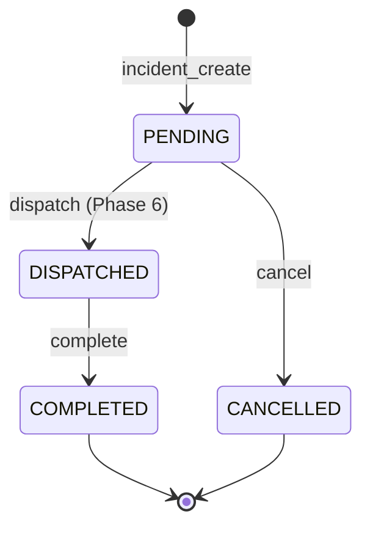

# Phase 3 — Incident Management and the Priority Queue (Max-Heap)

> **Verification status (2026-11-19 17:11)**
>
> | Program | Compiled, 0 warnings | `make analyze` clean | Hand-reviewed | **Executed** |
> |---|---|---|---|---|
> | `test_incident` | ✅ | ✅ | ✅ | ❌ **not yet** (blocked by Smart App Control) |
> | `test_incident_heap` | ✅ | ✅ | ✅ | ❌ **not yet** (blocked by Smart App Control) |
>
> No Phase 3 test has been run, so **none is marked as passed**. All "expected" values below
> were worked out by hand. See `docs/TEST_REPORT.md`.

## Files in this phase

| File | Status | Contents |
|---|---|---|
| `src/incident.h` / `src/incident.c` | **new** | `IncidentType`, `IncidentStatus`, `Incident`, `IncidentStore`; names, validation, creation, priority rule, state machine, listing |
| `src/incident_heap.h` / `src/incident_heap.c` | **new** | `IncidentHeap`: insert, extract-max, peek, heapify-up/down, copy, two display modes, invariant checker |
| `tests/test_incident.c` | **new** | 6 test functions |
| `tests/test_incident_heap.c` | **new** | 6 test functions, including the hand-traced 7-incident example and 2,000 random incidents |
| `Makefile` | **modified** | two new test programs; `TEST_SOURCES` list used by `make analyze` |
| `docs/TEST_REPORT.md` | **modified** | Phase 3 rows and the 17:11 run log |

No Phase 1 or Phase 2 source file was changed.

### Design details decided in this phase (please review)

1. **`incident_create` takes `num_locations`** instead of a `Graph *`. This lets it check
   that the location exists, while the incident module stays independent of the graph
   (blueprint layering: Layer 2 does not need Layer 1's graph).
2. **`incident_store_find` is a linear search (O(n)) for now.** Phase 5 adds an O(1) hash
   index. The linear version stays as a simple reference that the hash table can be tested
   against, the same idea as the O(V²) Dijkstra.
3. **The heap refuses non-PENDING incidents** (`DC_ERR_STATE`), so a dispatched or cancelled
   incident can never be queued by mistake.
4. **A third, defensive tie-break: lower ID.** `reported_seq` is meant to be unique, so this
   should never decide anything. It guarantees a strict order even if a corrupted CSV
   (Phase 7) contains two equal sequence numbers.
5. **Listings show location IDs, not names.** The incident module does not know the graph;
   the menu (Phase 9) can pass names into `incident_print_row`.
6. **Loading saved incidents with other statuses** (DISPATCHED, COMPLETED, …) is deliberately
   **not** provided yet. `incident_create` always makes PENDING incidents. Phase 7 will add a
   separate, clearly named restore function, so normal code cannot create a COMPLETED
   incident by accident.

---

## A. Purpose

- **`incident`** defines what an emergency *is*, refuses invalid emergencies, defines which
  emergency is *more urgent*, and controls how an emergency's status may change.
- **`IncidentStore`** is the single **owner** of every incident record: it keeps them in
  registration order for "View all incidents" and frees them at shutdown.
- **`incident_heap`** is the **priority queue** of pending emergencies. The dispatch engine
  (Phase 6) asks it *"which emergency next?"* in O(log n).

---

## B. Concepts you need first

### B1. `enum`: named integer constants

```c
typedef enum { INC_MEDICAL = 0, INC_ROAD_ACCIDENT, INC_FIRE, INC_STRUCTURAL_RESCUE,
               INC_TYPE_COUNT } IncidentType;
```

The values are 0, 1, 2, 3, 4. The final `INC_TYPE_COUNT` is a common trick: it equals the
number of real types, so arrays and loops can be sized with it and stay correct when a type
is added. C does **not** stop you storing 7 in an `IncidentType`, so every function that
receives one checks its range (`is_valid_type`).

### B2. Lookup tables instead of long `if`/`switch` chains

```c
static const char *const TYPE_NAMES[INC_TYPE_COUNT] = { "MEDICAL", "ROAD_ACCIDENT", ... };
```

- The enum value is the **index** into the table, so name lookup is O(1).
- `static` keeps the table private to `incident.c`.
- `const char *const` means neither the strings nor the pointers can be changed. It is
  read-only, so it is not the risky kind of global variable.
- Reverse lookup (`"FIRE"` → `INC_FIRE`) loops over the table with `strcmp`. Phase 7 will use
  this to read CSV files.

### B3. Finite state machines

A **state machine** lists the allowed states and the allowed **transitions** between them.
Anything not listed is illegal.



All status changes go through **one** function, `incident_set_status`, which asks
`incident_can_transition`. This one choke point means a bug elsewhere cannot, for example,
complete an incident that was never dispatched.

### B4. Owned vs borrowed pointers

```
IncidentStore.items:  [ ptr ][ ptr ][ ptr ] ...        ← OWNER: frees the records
                         │      │      │
                         ▼      ▼      ▼
                     Incident Incident Incident        ← each malloc'd once, never moves
                         ▲      ▲
IncidentHeap.data:   [ ptr ][ ptr ]                    ← BORROWER: frees only its own array
```

- Each `Incident` is `malloc`'d **individually**.
- When the store's array grows, `realloc` may **move the array of pointers**, but the records
  stay where they are. So every pointer held by the heap stays valid.
  `test_store` checks this: after 49 more additions and several reallocations,
  `store.items[0]` is still the same address.
- **Only the owner frees.** `incident_heap_free` frees the heap's array and never the
  incidents. If both freed the incidents, that would be a **double free**, which is
  undefined behaviour.

### B5. Priority queue, max-heap and comparator

A **priority queue** hands back the "most important" item first. A **max-heap** implements it
exactly like Phase 2's min-heap, except that the comparison flips. "Max" here means *highest
priority*, defined by one comparator function:

```c
int incident_higher_priority(const Incident *a, const Incident *b) {
    if (a->severity != b->severity)       return a->severity > b->severity;      // rule 1
    if (a->reported_seq != b->reported_seq) return a->reported_seq < b->reported_seq; // rule 2
    return a->id < b->id;                                                         // rule 3
}
```

A good comparator must define a **strict order**. Never "a before a" (irreflexive). Never
both "a before b" and "b before a" (asymmetric). Consistent across three items (transitive).
Ours compares a tuple (severity↓, seq↑, id↑) in order, which satisfies all three, and the
tests check the first two directly.

### B6. Why store pointers in the heap and not whole structs?

- **Speed:** a swap moves two 8-byte pointers instead of two 40-byte records.
- **Single source of truth:** when dispatch changes `inc->status`, every structure that
  points to the record sees the change at once. Copies would silently go out of date.
- **Cost:** we must respect the ownership rule (B4).

### B7. Lazy deletion for cancellation

Cancelling only sets `status = CANCELLED`; the pointer stays inside the heap. Whoever
extracts it later sees it is no longer PENDING and discards it. Removing it immediately would
need its position in the heap array, which the heap does not track. Cost: cancelled entries
occupy space until they reach the top. Alternative: store each incident's heap index and
implement `remove_at(i)` in O(log n).

### B8. Displaying a heap in priority order = heap sort

The heap array is **not sorted** (look at the array in E1: 1007 comes before 1001 but after
1005). To print in true priority order, we copy the pointer array and repeatedly
extract-max from the copy. That is exactly **heap sort**, O(n log n), and the real queue is
untouched.

---

## C. Code (where things are)

- `src/incident.h`: enums, structs, every function's contract. Read this first.
- `src/incident.c`: name tables → validation and creation → priority → state machine →
  display → store.
- `src/incident_heap.h`: the array formulas, the invariant, and the ownership rule as comments.
- `src/incident_heap.c`: `swap_slots`, `heapify_up`, `heapify_down` and `grow` (private),
  then the public functions.

---

## D. Code walkthrough

### D1. `incident_validate` and `incident_create`

Checks, in order: ID ≥ 1, type in range, severity 1–5, `reported_seq` ≥ 0, and
`0 ≤ location_id < num_locations` (with `num_locations` ≥ 1). `incident_create`:

1. sets `*out = NULL` first, so the caller never sees a stale pointer on failure;
2. validates **before** allocating, so invalid input cannot leak memory;
3. `malloc`s, fills **every** field (status `PENDING`, resource −1, attempts 0), and hands the
   pointer back. The caller must give it to the store, or `free` it.

### D2. `incident_can_transition`

A `switch` on the current status. Listing every enum value, including `INC_STATUS_COUNT`,
lets the compiler's `-Wswitch` warning flag a forgotten case if a status is ever added. The
final `return 0` handles out-of-range values.

### D3. `incident_print_row`

Builds the location and severity columns in small local buffers with `snprintf`, which never
overflows (the location buffer is sized for the longest possible ID plus a 31-character
name). Then it prints one aligned row. `-` means no resource is assigned.

### D4. The store

| Function | Key points |
|---|---|
| `incident_store_init` | Safe empty state first, then validate, then allocate. |
| `incident_store_add` | Rejects `NULL` and duplicate IDs **before** changing anything. Grows by doubling through a temporary pointer (a failed `realloc` loses nothing). If it fails, **ownership stays with the caller**, which is why the test frees the rejected duplicate itself. |
| `incident_store_find` | Linear scan, O(n). Replaced for lookups by the hash table in Phase 5. |
| `incident_store_free` | Frees each record (it is the owner), then the array; resets to empty so a second call is harmless. |

### D5. The heap

| Function | Key points |
|---|---|
| `heapify_up` | While the item outranks its parent, swap with the parent. |
| `heapify_down` | Choose the **higher-priority child**, and swap only if that child outranks the item. Choosing the lower one would put a less urgent incident above a more urgent sibling. |
| `incident_heap_insert` | Validates (including PENDING), grows if full, places the pointer in the first free slot, heapifies up. |
| `incident_heap_extract_max` | Sets `*out = NULL` first. Takes the root, moves the last pointer to the root, heapifies down. |
| `incident_heap_copy` | Copying the array as-is keeps a valid heap: the parent/child relationships are positional. |
| `incident_heap_print_array` | Shows each slot with its parent index: the real, unsorted heap. |
| `incident_heap_print_priority_order` | Heap sort on a copy (B8); `pending_only` hides lazily deleted entries; returns the count printed. |

**Code reuse question:** `incident_heap.c` repeats the structure of `minheap.c`. A single
"generic heap" storing `void *` elements with a comparator **function pointer** would remove
the repetition, at the cost of losing type checking and adding a function-pointer call on
every comparison. With only two heaps, we chose two small, type-safe, easy-to-explain
modules. Be ready to discuss this trade-off in the viva.

---

## E. Example execution (hand trace)

### E1. Seven incidents inserted in registration order

| ID | Type | Loc | Sev | Seq |
|---|---|---|---|---|
| 1001 | MEDICAL | 5 | 3 | 1 |
| 1002 | FIRE | 2 | 5 | 2 |
| 1003 | ROAD_ACCIDENT | 6 | 3 | 3 |
| 1004 | STRUCTURAL_RESCUE | 4 | 4 | 4 |
| 1005 | MEDICAL | 0 | 5 | 5 |
| 1006 | FIRE | 7 | 1 | 6 |
| 1007 | ROAD_ACCIDENT | 1 | 4 | 7 |

| Insert | Starts at slot | Heapify-up | Array afterwards (IDs) |
|---|---|---|---|
| 1001 (s3) | 0 | — | 1001 |
| 1002 (s5) | 1 | outranks 1001 (5 > 3): swap to slot 0 | 1002, 1001 |
| 1003 (s3) | 2 | parent 1002 (s5) is higher: stop | 1002, 1001, 1003 |
| 1004 (s4) | 3 | outranks 1001 (4 > 3): swap to slot 1; parent 1002 higher: stop | 1002, 1004, 1003, 1001 |
| 1005 (s5) | 4 | outranks 1004 (5 > 4): swap to slot 1; parent 1002 is also s5 but **reported earlier** (seq 2 < 5): stop | 1002, 1005, 1003, 1001, 1004 |
| 1006 (s1) | 5 | parent 1003 (s3) higher: stop | 1002, 1005, 1003, 1001, 1004, 1006 |
| 1007 (s4) | 6 | outranks 1003 (4 > 3): swap to slot 2; parent 1002 higher: stop | **1002, 1005, 1007, 1001, 1004, 1006, 1003** |

The resulting tree:

```
                    1002 (s5,q2)
                 /               \
        1005 (s5,q5)            1007 (s4,q7)
         /        \              /         \
 1001 (s3,q1) 1004 (s4,q4)  1006 (s1,q6) 1003 (s3,q3)
```

Every parent outranks its children, but siblings and cousins are in no particular order. For
example, slot 3 (1001, s3) comes before slot 4 (1004, s4) in the array. The heap is not
sorted, only parent-ordered.

### E2. First extract-max

1. Remove the root, **1002**. Move the last slot (1003) to the root:
   `1003, 1005, 1007, 1001, 1004, 1006`.
2. Heapify-down at slot 0. The children are 1005 (s5) and 1007 (s4); the better one is 1005,
   which outranks 1003, so swap: `1005, 1003, 1007, 1001, 1004, 1006`.
3. At slot 1, the children are slot 3 = 1001 (s3, q1) and slot 4 = 1004 (s4); the better one
   is 1004, which outranks 1003, so swap: `1005, 1004, 1007, 1001, 1003, 1006`.
4. Slot 4 has no children (2·4+1 = 9 ≥ 6), so stop.

**Final:** `1005, 1004, 1007, 1001, 1003, 1006`. This is what `test_seven_incident_example`
expects.

The full service order is **1002, 1005, 1004, 1007, 1001, 1003, 1006**: both severity-5
incidents first (earlier report first), then the severity-4s, then the 3s, then the 1.

### E3. What the debug view should print (predicted, not yet observed)

```
SLOT  PARENT ID     SEV     SEQ  STATUS
0     -      1002   5         2  PENDING
1     0      1005   5         5  PENDING
2     0      1007   4         7  PENDING
3     1      1001   3         1  PENDING
4     1      1004   4         4  PENDING
5     2      1006   1         6  PENDING
6     2      1003   3         3  PENDING
```

---

## F. Testing

### F1. Commands (MSYS2 UCRT64 shell, in the project folder)

```bash
make all
```
```bash
make analyze
```
```bash
make test
```

Without make:

```bash
mkdir -p build && gcc -std=c11 -Wall -Wextra -Wpedantic -g -Isrc -Itests -o build/test_incident_heap tests/test_incident_heap.c src/incident_heap.c src/incident.c src/common.c
```

### F2. What the tests validate

**`test_incident.c`**

| Test | Validates | Kind |
|---|---|---|
| `test_names` | every type/status name round-trips; case-sensitive; unknown, empty and `NULL` names; out-of-range enums print `?`; severity labels | normal/edge |
| `test_validation` | minimum and maximum valid values; each field invalid on its own, including enum values −1 and `COUNT`, and an empty city | boundary/failure |
| `test_create` | every field initialised; failure leaves `*out == NULL`; `NULL` output | normal/failure |
| `test_priority_rule` | each of the 3 rules in both directions; never outranks itself | correctness |
| `test_state_machine` | the **whole 4×4 transition table**; illegal moves leave the status unchanged | correctness |
| `test_store` | growth from capacity 1 to 50; **records do not move when the array grows**; find; duplicate rejected and ownership stays with the caller; filtered listing; double free safe | ownership/edge |

**`test_incident_heap.c`**

| Test | Validates | Kind |
|---|---|---|
| `test_init_and_empty` | invalid capacity; extract/peek on empty returns `DC_ERR_EMPTY` and `*out = NULL`; `NULL`s; insert after free | failure |
| `test_rejects_non_pending` | a cancelled incident cannot be queued | state |
| `test_seven_incident_example` | exact array after inserts (E1) and after one extraction (E2); full order; invariant after every step; extracted pointer **is** the stored record; records untouched | normal |
| `test_ties` | equal severity → earlier report; equal severity and seq → lower ID | tie-break |
| `test_copy_and_priority_listing` | the copy is independent; listing skips a cancelled entry (2 shown) or includes it (3); listing never changes the heap | lazy deletion |
| `test_random_stress` | 2,000 random severities, starting from capacity 1: invariant after every insert and extract; every extracted incident outranks the next | stress |

**Not covered:** out-of-memory paths (code review only). Printed listings are checked by eye.
No Phase 3 test has been executed yet.

---

## G. Complexity

n = incidents in the heap, N = incidents in the store.

| Operation | Time | Space |
|---|---|---|
| `incident_validate`, `incident_create` | O(1) | O(1) per incident |
| `incident_higher_priority`, `incident_set_status` | O(1) | — |
| `incident_type_from_name` | O(T), T = 4 types | — |
| `incident_store_add` | O(N) (duplicate scan) + O(1) amortised append | — |
| `incident_store_find` | O(N) (→ O(1) average with the Phase 5 hash) | — |
| `incident_store_print` | O(N) | — |
| **heap insert** | **O(log n)** (amortised, because of doubling) | — |
| **heap extract-max** | **O(log n)** | — |
| heap peek / size | O(1) | — |
| heap copy | O(n) | O(n) |
| `print_array` | O(n) | — |
| `print_priority_order` | O(n log n) | O(n) |
| Whole heap | — | O(n) pointers |

**Why is insert O(log n)?** Heapify-up climbs at most the tree's height, ⌊log₂ n⌋. With
1,000 pending incidents, that is at most 9 swaps.

**Alternatives:**

| Structure | insert | extract highest |
|---|---|---|
| Unsorted array | O(1) | O(n) |
| Sorted array | O(n) | O(1) |
| Sorted linked list | O(n) | O(1) |
| **Binary heap** | **O(log n)** | **O(log n)** |

---

## H. Viva preparation

**Basic**

1. *Why a max-heap for incidents?* We repeatedly need the most urgent pending incident, while
   new incidents keep arriving. A heap does both insert and extract in O(log n).
2. *State the priority rule.* Higher severity first; same severity, earlier report first;
   (defensive) lower ID.
3. *What is the heap invariant here?* No child outranks its parent, so the root is the most
   urgent incident.
4. *How are parent and child found?* parent (i−1)/2, children 2i+1 and 2i+2.

**Tricky**

5. *Is the heap array sorted?* No. Only parent-over-child order holds. In E1, slot 3 holds
   1001 (severity 3) and slot 4 holds 1004 (severity 4): a less urgent incident comes first
   in the array. To list in order, we heap-sort a copy.
6. *Why use a sequence number instead of the real time?* Real timestamps can tie within the
   same second, and they make tests irreproducible. A counter is unique and deterministic.
7. *If seq is unique, why a third tie-break?* Defence against corrupted data from files: it
   keeps the order strict, so results stay deterministic even then.
8. *An incident is cancelled while it is in the heap. What happens?* Lazy deletion: its status
   becomes CANCELLED and it stays in the array. Dispatch discards it when extracted, and the
   listing skips it.
9. *Can a dispatched incident be cancelled?* No. The state machine forbids it (recall of a
   moving unit is out of scope). `incident_set_status` returns `DC_ERR_STATE`.
10. *Why does heapify-down pick the higher-priority child?* That child becomes the parent of
    the other one, so it must outrank it.
11. *Could two heaps share one implementation?* Yes, with `void *` and a comparator function
    pointer. We traded that reuse for type safety and simplicity (D5).

**Complexity**

12. *Insert and extract?* O(log n). Peek O(1). Priority listing O(n log n).
13. *Why not keep a sorted array?* Each insert would shift up to n elements: O(n).
14. *Cost of adding to the store?* O(N), because of the duplicate scan. (Corrected in
    Phase 5: the hash table makes **lookups by ID** O(1) on average, but the store keeps its
    own duplicate scan as a safety check, so registration stays O(N). See
    `docs/PHASE5_HASHING.md`, section G.)

**Pointers and memory**

15. *Who frees an incident?* Only the `IncidentStore`. The heap only borrows pointers.
16. *What happens if the store's array is reallocated? Do heap pointers break?* No. Only the
    array of pointers moves; each record stays at its own `malloc`'d address.
17. *Why does `incident_create` set `*out = NULL` first?* So on any failure the caller holds
    `NULL` rather than an old or garbage pointer that might be freed or used.
18. *What happens if the store rejects a duplicate?* Ownership never transferred, so the
    caller must free that incident. Otherwise it leaks.

**Integration**

19. *How will dispatch use the heap?* Extract the top incident; if it is not PENDING, discard
    it (lazy deletion). Otherwise try to allocate a resource. Incidents that can't be served
    are collected and re-inserted after the bounded pass (blueprint §10).
20. *Where does `reported_seq` come from?* The simulated clock in `AppState` (Phase 5/6),
    incremented on every event.

---

## I. Team explanation

| Member | Must understand | Independently validate |
|---|---|---|
| **M1 (lead)** | Ownership (B4), the state machine, the design details above | Approve `incident.h` and `incident_heap.h`; Phases 5 and 6 depend on them |
| **M2 (priority queue)** — primary validator | All of B5–B8, D5, E1–E2, G | (1) Redo E1 and E2 by hand **without looking**. (2) Insert the same 7 incidents in reverse ID order, predict the array, and add it as a new test. (3) Explain why the comparator is a strict order. (4) Write the complexity comparison table yourself. (5) Review `incident_heap.c` line by line. |
| **M3 (graph)** | How `location_id` links an incident to a graph vertex | Confirm that `num_locations` passed by the app will equal `graph->num_vertices` |
| **M4 (records)** | Store, ownership, name tables (used by CSV in Phase 7), state machine | Check the 4×4 transition table against blueprint §9; list which CSV values the loader must reject |
| **M5 (testing)** | Evidence levels; the random stress test | Update `TEST_REPORT.md` if any run is allowed; design an end-to-end scenario of incident registration for Phase 9 |

---

## J. Integration

- **Dependencies introduced:** `incident → common`; `incident_heap → incident, common`.
  Neither depends on the graph, the min-heap or Dijkstra, and nothing from Phases 1–2 depends
  on them.
- **Used next by:**
  - Phase 5: the hash table indexes incidents by ID.
  - Phase 6: `AppState` holds the `IncidentStore` and the `IncidentHeap`; the dispatch engine
    extracts, calls Dijkstra, and calls `incident_set_status`.
  - Phase 7: the name tables and validation for CSV.
  - Phase 9: the menu listings.
- **Build:** `make all`, `make analyze`, `make test`.

### Suggested Git steps (for you to run; I have not run any Git command)

```bash
git switch -c feature/phase3-incidents
```
```bash
git status
```
```bash
git add src/incident.h src/incident.c src/incident_heap.h src/incident_heap.c tests/test_incident.c tests/test_incident_heap.c Makefile docs/PHASE3_INCIDENTS.md docs/TEST_REPORT.md
```
```bash
git commit -m "Phase 3: incident records, state machine and max-heap priority queue with tests"
```

Then push and open a Pull Request with **Member 2** as the reviewer.
