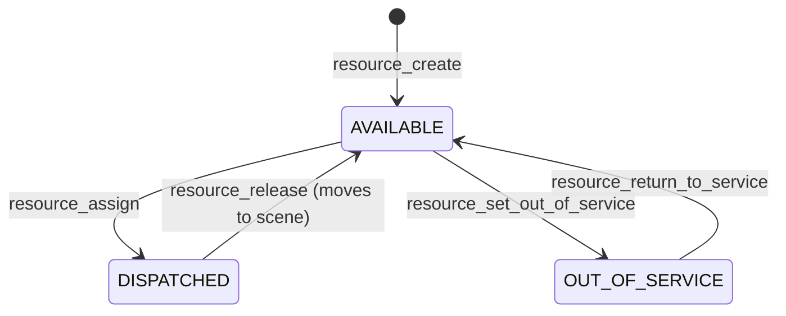

# Phase 4 — Resource Management and Compatibility Rules

> **Verification status (2026-11-19 17:36)**
>
> | Program | Compiled, 0 warnings | `make analyze` clean | Hand-reviewed | **Executed** |
> |---|---|---|---|---|
> | `test_resource` | ✅ | ✅ | ✅ | ❌ **not yet** (blocked by Smart App Control) |
> | `test_compatibility` | ✅ | ✅ | ✅ | ❌ **not yet** (blocked by Smart App Control) |
>
> No Phase 4 test has been run, so **none is marked as passed**. See `docs/TEST_REPORT.md`.

## Files in this phase

| File | Status | Contents |
|---|---|---|
| `src/resource.h` / `src/resource.c` | **new** | `ResourceType`, `ResourceStatus`, `Resource`, `ResourceStore`; names, validation, creation, state machine (assign / release / service changes), listing |
| `src/compatibility.h` / `src/compatibility.c` | **new** | the 4×3 rule table, the eligibility filter, a table sanity check, printing |
| `tests/test_resource.c` | **new** | 7 test functions, including 5,000 random operations |
| `tests/test_compatibility.c` | **new** | 3 test functions using the reference fleet |
| `Makefile` | **modified** | two new test programs |
| `docs/TEST_REPORT.md` | **modified** | Phase 4 rows and the 17:36 run log |

No source file from Phases 1–3 was changed.

### Design details decided in this phase (please review)

1. **No general `resource_set_status()` function.** The only way into or out of DISPATCHED is
   `resource_assign` / `resource_release`, which change the status **and** the assigned
   incident together. Service changes have their own two functions. This makes the rule *"a
   dispatched unit cannot be assigned again until released"* impossible to bypass.
2. **Release moves the unit to the incident's location** (blueprint decision D9).
3. **`total_distance` is `long long`.** `long` is only 32 bits on Windows, so a long-running
   simulation could overflow it.
4. **`resource_assign` accepts distance 0.** A unit already at the incident's location has a
   zero-length route.
5. **`ResourceStore` repeats the `IncidentStore` pattern** rather than using a shared generic
   store. The trade-off is discussed in D5.
6. **The resource fleet from blueprint §10** (R1–R6) is used in the tests, so Phase 6 can
   continue the same worked example.

---

## A. Purpose

- **`resource`** defines an emergency unit, refuses invalid units, and, most importantly,
  **guarantees that a unit is never sent to two incidents at once**.
- **`ResourceStore`** owns all units and keeps them **in registration order**. Phase 10's
  baseline strategy ("first compatible available unit in the list") depends on that order.
- **`compatibility`** holds the project's rules about which unit type may serve which
  emergency type. The dispatch engine uses its **eligibility filter** *before* it ever looks
  at distance.

---

## B. Concepts you need first

### B1. A state machine with an invariant



Unlike incidents, units have **no final state**: they cycle through duty again and again.

An **invariant** is a statement that must be true at all times. Ours:

> `status == DISPATCHED` **if and only if** `assigned_incident_id != -1`.

If one function changed the status and another changed the assignment, a bug between the two
calls could break that statement. By changing both **in the same function**, the module makes
the invariant impossible to break from outside. This is **encapsulation**: hiding *how* data
changes behind functions that keep it consistent.

### B2. Why "filter first, optimise second"

The dispatch rule is: compatibility → availability → reachability → **then** shortest
distance. If we picked the nearest unit and *then* checked compatibility, we would need
complicated "try the next nearest" logic, and a bug could send a fire engine to a heart
attack. Filtering first means distance is only ever compared between units that are **all
acceptable**. `compat_is_eligible` is that filter.

### B3. Two-dimensional lookup tables

```c
static const int COMPAT[INC_TYPE_COUNT][RES_TYPE_COUNT] = { {1,0,0}, {1,0,1}, {0,1,0}, {0,0,1} };
```

`COMPAT[it][rt]` is row `it` (incident type), column `rt` (resource type). In memory, C
stores the rows one after another. A lookup is O(1). Changing a rule means changing one
`0`/`1`; no `if` chains need editing. **Bounds checking** is essential: an out-of-range enum
value such as 7 would read memory outside the table, which is undefined behaviour. So
`compat_is_compatible` checks both indices first.

### B4. Dependency direction

```
compatibility ──► incident
      │
      └────────► resource
```

`resource` and `incident` know nothing about each other. If the table lived in `resource.c`,
that file would need `incident.h` (and vice versa), tangling the modules. A tiny separate
module keeps every arrow one-directional, so there can be no circular include.

### B5. Integer widths on Windows

| Type | Windows (MSYS2 UCRT64) | Linux 64-bit |
|---|---|---|
| `int` | 32 bits | 32 bits |
| `long` | **32 bits** | 64 bits |
| `long long` | 64 bits | 64 bits |

Portable code chooses `long long` (or `<stdint.h>` types) whenever it needs more than 32 bits.
`%lld` is the matching `printf` format.

---

## C. Code (where things are)

- `src/resource.h`: the invariant and ownership rule as comments, then the interface.
- `src/resource.c`: name tables → validation and creation → state machine → display → store.
- `src/compatibility.h`: the rule table drawn as a comment, then the interface.
- `src/compatibility.c`: the `COMPAT` table and five small functions.

---

## D. Code walkthrough

### D1. `resource_create`

The same safe pattern as `incident_create`: set `*out = NULL`, validate (ID ≥ 1, type in
range, location in range), `malloc`, set **every** field (AVAILABLE, no incident, zero
statistics), return.

### D2. `resource_assign(r, incident_id, distance)`

1. Reject `NULL`, `incident_id < 1` and `distance < 0` with `DC_ERR_INVALID`.
2. Ask the state machine whether the current status may become DISPATCHED. Only AVAILABLE may.
   Otherwise return `DC_ERR_STATE`.
3. Only now change the status, the assigned incident and both statistics, together.

All checks happen before any change, so a failed call leaves the unit **exactly** as it was.
`test_assign_and_release` checks that a refused second assignment does not increase
`total_dispatches`.

### D3. `resource_release(r, new_location, num_locations)`

Validates the location **before** checking the status, then sets AVAILABLE, clears the
assigned incident, and moves the unit. Statistics are not changed: the trip was counted when
it was assigned.

### D4. Service changes

`change_service(r, from, to)` is a private helper used by both public functions. It succeeds
only if the current status is exactly `from`. So:

- an available unit can go out of service;
- an out-of-service unit can return;
- **a dispatched unit can do neither** (`DC_ERR_STATE`).

### D5. The store, and the duplication question

`ResourceStore` has the same shape as `IncidentStore`: owned pointers, doubling growth,
duplicate-ID check, ordered listing, a free function that frees the records.

**Could one generic store serve both?** Yes, using `void **items` and a function pointer to
read an item's ID. We chose two small typed stores because:

1. the compiler can then catch "added a `Resource *` to the incident store";
2. there is no casting in calling code;
3. each is ~70 lines and easy to explain.

The cost is repeated code. This is a reasonable viva discussion point. Phase 5's hash table,
by contrast, *is* generic (`void *`), because there the shared logic is substantial.

`resource_store_count_status` will feed the System Statistics screen (Phase 8).

### D6. `compatibility.c`

| Function | Purpose |
|---|---|
| `compat_is_compatible` | bounds-checked table lookup |
| `compat_is_eligible` | compatible **and** `resource_is_available`: the dispatch filter |
| `compat_count_options` | how many unit types can serve an incident type |
| `compat_table_is_complete` | self-check: every incident type has at least one option, so no emergency is unservable **by design** |
| `compat_print_options` | builds messages such as "needs AMBULANCE or RESCUE_UNIT" (Phase 6) |
| `compat_print_matrix` | displays the rules |

### D7. The random-operation test

`test_random_operation_sequence` performs 5,000 random assign / release / out-of-service /
return operations on 5 units. Most fail with `DC_ERR_STATE`, which is the point: it checks
that **no sequence of calls**, legal or illegal, can ever break the invariant from B1.

---

## E. Example execution

### E1. The reference fleet (blueprint §10)

| Unit | Type | Location |
|---|---|---|
| R1 | AMBULANCE | 0 Central Hospital |
| R2 | AMBULANCE | 6 Airport Road |
| R3 | FIRE_UNIT | 2 Fire Station North |
| R4 | RESCUE_UNIT | 4 Industrial Zone |
| R5 | FIRE_UNIT | 7 University |
| R6 | AMBULANCE | 8 Hill Village (island) |

### E2. Eligibility for each incident type (all units available)

| Incident type | R1 | R2 | R3 | R4 | R5 | R6 |
|---|---|---|---|---|---|---|
| MEDICAL | ✅ | ✅ | – | – | – | ✅ |
| ROAD_ACCIDENT | ✅ | ✅ | – | ✅ | – | ✅ |
| FIRE | – | – | ✅ | – | ✅ | – |
| STRUCTURAL_RESCUE | – | – | – | ✅ | – | – |

For the blueprint's medical emergency at Old Town (5), the eligible set is {R1, R2, R6}.
R5 is *physically* the closest unit (8 away) but is never even considered. R6 is eligible but
unreachable; Phase 6 will discard it after running Dijkstra. Phase 6 will then pick R1
(distance 9) from R1 and R2.

### E3. A unit's life

| Step | Call | Status | Assigned | Location | Trips | Distance |
|---|---|---|---|---|---|---|
| 1 | `resource_create(1, AMBULANCE, 0)` | AVAILABLE | – | 0 | 0 | 0 |
| 2 | `resource_assign(r, 1001, 9)` | DISPATCHED | 1001 | 0 | 1 | 9 |
| 3 | `resource_assign(r, 1002, 4)` | **refused** (`DC_ERR_STATE`) | 1001 | 0 | 1 | 9 |
| 4 | `resource_set_out_of_service(r)` | **refused** | 1001 | 0 | 1 | 9 |
| 5 | `resource_release(r, 5, 10)` | AVAILABLE | – | **5** | 1 | 9 |
| 6 | `resource_assign(r, 1003, 6)` | DISPATCHED | 1003 | 5 | 2 | 15 |

This is what `test_assign_and_release` checks.

### E4. Predicted matrix printout (trailing spaces omitted)

```
INCIDENT \ UNIT     AMBULANCE    FIRE_UNIT    RESCUE_UNIT
MEDICAL             yes          -            -
ROAD_ACCIDENT       yes          -            yes
FIRE                -            yes          -
STRUCTURAL_RESCUE   -            -            yes
```

---

## F. Testing

### F1. Commands (MSYS2 UCRT64 shell, project folder)

```bash
make all
```
```bash
make analyze
```
```bash
make test
```

Without make:

```bash
mkdir -p build && gcc -std=c11 -Wall -Wextra -Wpedantic -g -Isrc -Itests -o build/test_compatibility tests/test_compatibility.c src/compatibility.c src/resource.c src/incident.c src/common.c
```

### F2. What the tests validate

**`test_resource.c`**

| Test | Validates | Kind |
|---|---|---|
| `test_names` | names round-trip; case-sensitive; unknown and `NULL`; out-of-range enums print `?` | normal/edge |
| `test_create` | boundary locations; every invalid field; all fields initialised; `*out = NULL` on failure | boundary/failure |
| `test_transition_table` | the whole 3×3 transition table | correctness |
| `test_assign_and_release` | life cycle E3; **no double assignment**; refused calls change nothing (including statistics); release relocates; reuse accumulates statistics; distance 0 accepted | core rule |
| `test_service_changes` | out of service / return; an out-of-service unit cannot be assigned; `NULL` handling | state |
| `test_random_operation_sequence` | 5,000 random operations never break the invariant | stress |
| `test_store` | **registration order kept** (IDs 7, 2, 9, 4); duplicates; find; per-status counts; listings; double free safe | ownership |

**`test_compatibility.c`**

| Test | Validates | Kind |
|---|---|---|
| `test_matrix` | all 12 cells; four out-of-range enum combinations return 0 | correctness/safety |
| `test_counts_and_completeness` | options per type (1, 2, 1, 1); table completeness; printing | correctness |
| `test_eligibility_with_reference_fleet` | table E2; the closest-but-incompatible R5 is never eligible; eligibility changes after dispatch, out of service and release | integration |

**Not covered:** out-of-memory paths (code review only); printed output is checked by eye;
nothing in Phase 4 has been executed yet.

---

## G. Complexity

R = resources in the store, T = number of resource types (3), I = incident types (4).

| Operation | Time | Space |
|---|---|---|
| `resource_validate`, `resource_create` | O(1) | O(1) per resource |
| `resource_assign`, `resource_release`, service changes | O(1) | — |
| `resource_type_from_name` | O(T) | — |
| `resource_store_add` | O(R) (duplicate scan) + O(1) amortised append | — |
| `resource_store_find` | O(R) (→ O(1) average with the Phase 5 hash) | — |
| `resource_store_count_status`, `resource_store_print` | O(R) | — |
| `compat_is_compatible`, `compat_is_eligible` | **O(1)** | — |
| `compat_count_options` | O(T) | — |
| `compat_table_is_complete` | O(I · T) | — |
| Filtering every unit for one incident (Phase 6) | O(R) | O(R) candidate list |
| The table itself | — | O(I · T) = 12 integers |

---

## H. Viva preparation

**Basic**

1. *What does "eligible" mean?* Compatible with the incident type **and** currently
   AVAILABLE.
2. *Where are the compatibility rules, and how would you change one?* In the `COMPAT` table in
   `compatibility.c`; change one 0/1 cell and rebuild.
3. *What are the resource states?* AVAILABLE, DISPATCHED, OUT_OF_SERVICE.
4. *What happens to a unit when its incident is completed?* It becomes AVAILABLE at the
   incident's location.

**Tricky**

5. *How do you guarantee that a unit is never assigned twice?* `resource_assign` refuses
   unless the status is AVAILABLE, and it sets DISPATCHED in the same call. There is no other
   way to reach DISPATCHED.
6. *Why is there no `resource_set_status()`?* It would let callers break the invariant (status
   DISPATCHED with no incident, or the reverse).
7. *Why filter by compatibility before computing distance?* So that distance is compared only
   among acceptable units. An incompatible unit can never win by being closer.
8. *Why can't a dispatched unit go out of service?* Project rule: it finishes its current job
   first. Otherwise its incident would be left with a unit that no longer exists.
9. *What does `compat_table_is_complete` protect against?* An edit to the table that leaves
   some incident type with no possible unit, which would make those incidents permanently
   unservable.
10. *Why must the store keep registration order?* The baseline strategy picks "the first
    compatible available unit in the list"; changing the order would change its results.

**Complexity**

11. *Cost of checking compatibility?* O(1): one table lookup.
12. *Cost of finding all eligible units for one incident?* O(R): one pass over the store.
13. *Why is `store_add` O(R)?* It scans for duplicate IDs. (Corrected in Phase 5: the hash
    table makes **lookups** O(1) on average, but the store keeps its own scan as a safety
    check, so registration stays O(R). See `docs/PHASE5_HASHING.md`, section G.)

**Pointers and memory**

14. *Who frees a `Resource`?* Only `resource_store_free`. Everything else borrows the pointer.
15. *Why `long long` for the total distance?* `long` is 32 bits on Windows and could
    overflow; `long long` is at least 64 bits everywhere.
16. *Why is the table declared `static const`?* `static` makes it private to the file and
    `const` makes it read-only. It cannot be changed by mistake, so it is not dangerous global
    state.

**Integration**

17. *How will dispatch use this module?* For the selected incident: loop over the store, keep
    units where `compat_is_eligible` is true, read each one's distance from Dijkstra's
    `dist[]`, pick the minimum (ties → lower ID), then call `resource_assign`. On completion:
    `resource_release(r, incident->location_id, ...)`.
18. *How will dispatch explain a failure?* "No compatible unit registered" if no unit in the
    store passes `compat_is_compatible`; "all compatible units busy" if some do but none pass
    `compat_is_eligible`; "unreachable" if all eligible units have `DC_INF` distance.

---

## I. Team explanation

| Member | Must understand | Independently validate |
|---|---|---|
| **M1 (lead)** | The invariant and why there is no generic `set_status`; the eligibility filter | Approve `resource.h` and `compatibility.h`; the Phase 6 failure messages (H18) |
| **M2 (priority queue)** | How resources relate to the incident priority order (they don't affect it) | Check that nothing in Phase 4 changes incident ordering |
| **M3 (graph)** | `location_id` as a graph vertex; relocation on release | Check that a released unit's new location is always a valid vertex |
| **M4 (resources/records)** — primary validator | Everything in this document | (1) Check every cell of the matrix against blueprint §8. (2) Reproduce table E2 by hand. (3) Trace E3 and predict the outcome of each call. (4) Add a test: a unit going out of service and returning to service three times keeps its statistics. (5) Review `resource.c` and `compatibility.c` line by line. |
| **M5 (testing)** | The random-operation test and why most of its calls fail | Keep `TEST_REPORT.md` current; plan the baseline experiment's dependence on registration order |

---

## J. Integration

- **Dependencies introduced:** `resource → common`; `compatibility → incident, resource`.
  Nothing from Phases 1–3 depends on Phase 4.
- **Used next by:**
  - Phase 5: the hash table indexes resources by ID.
  - Phase 6: `AppState` holds the `ResourceStore`, and the dispatch engine uses
    `compat_is_eligible`, `resource_assign` and `resource_release`.
  - Phase 7: the name tables for CSV.
  - Phase 8: `resource_store_count_status` for statistics.
- **Build:** `make all`, `make analyze`, `make test`.

### Suggested Git steps (for you to run; I have not run any Git command)

```bash
git switch -c feature/phase4-resources
```
```bash
git status
```
```bash
git add src/resource.h src/resource.c src/compatibility.h src/compatibility.c tests/test_resource.c tests/test_compatibility.c Makefile docs/PHASE4_RESOURCES.md docs/TEST_REPORT.md
```
```bash
git commit -m "Phase 4: resources, state machine and compatibility rules with tests"
```

Then push and open a Pull Request with **Member 4** as the reviewer.
